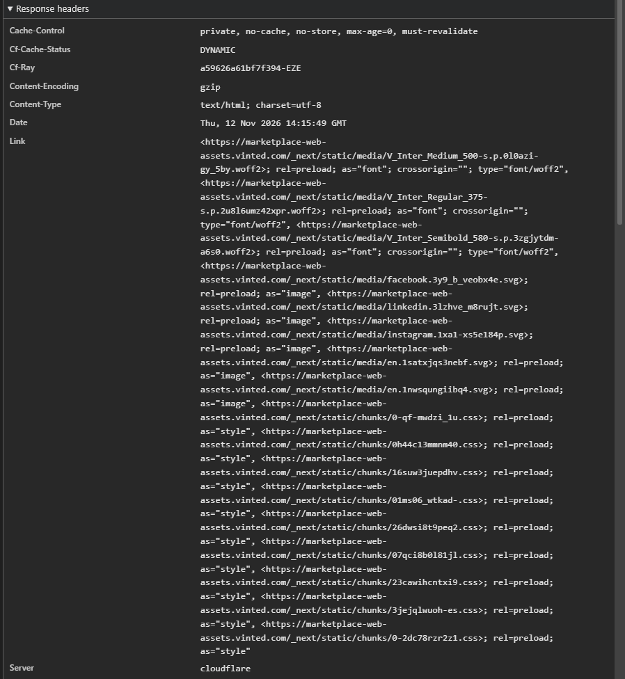
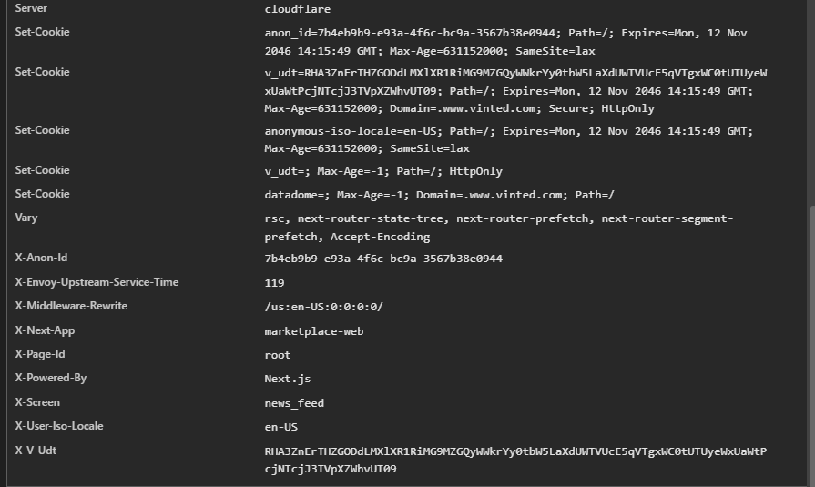
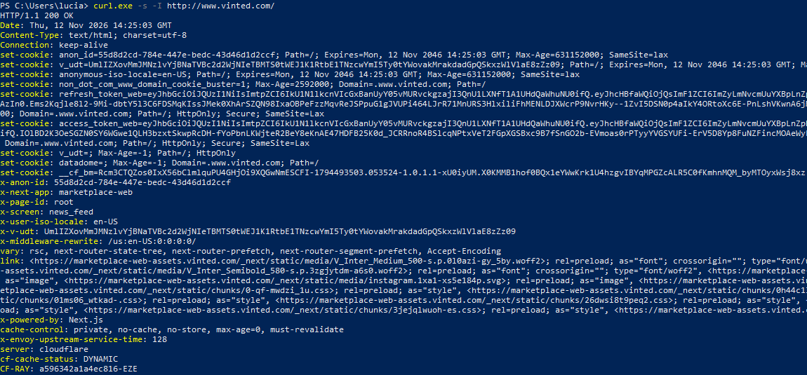

# Objetivo 1: Caza Pasiva de Configuraciones Inseguras en Entornos Reales

## Descripción

Para este objetivo volví a usar el programa **Vinted Bug Bounty** de Bugcrowd, el mismo del escaneo de Nmap del Módulo I. El objetivo fue `www.vinted.com`, que está *in scope*.

El análisis fue estrictamente pasivo. Entré al sitio como cualquier usuario, sin iniciar sesión, y miré las cabeceras de la respuesta en la pestaña *Network* de las herramientas de desarrollador. No hice fuzzing, ni inyecciones, ni ninguna prueba activa: solo las peticiones `GET` normales que hace un navegador al abrir la página, por `https://` y por `http://`.

Lo más relevante que encontré es que el sitio no fuerza el uso de HTTPS, y eso es lo que reporto. Al final dejo otras observaciones.

---

# Hallazgo de Seguridad: www.vinted.com se sirve por HTTP sin cifrar y sin HSTS

| Campo | Valor |
| --- | --- |
| Nombre | Falta de HSTS y sitio accesible por HTTP sin redirección a HTTPS |
| Categoría | A05:2021 Security Misconfiguration / CWE-319: Cleartext Transmission of Sensitive Information |
| Versión | N/A (No Aplica) |
| Vector CVSS | 3.7 (Baja) - `CVSS:3.1/AV:A/AC:H/PR:N/UI:R/S:U/C:L/I:L/A:N` |
| URL afectada(s) | `GET http://www.vinted.com/`<br>`GET https://www.vinted.com/` |
| Fecha | 2026-11-12 |

## Descripción

El sitio de Vinted se puede usar completo por una conexión sin cifrar, y no le indica al navegador que tiene que usar siempre la versión segura. Si un usuario entra desde un link `http://` estando en una red compartida, por ejemplo un wifi público, alguien en esa misma red puede ver qué páginas visita y modificar lo que le muestra, incluso el formulario de login. Hace falta que se den varias condiciones, así que el riesgo es bajo, pero se corrige solo con configuración.

## Detalles de la vulnerabilidad

Encontré dos problemas que, juntos, dejan al sitio sin protección contra la intercepción de tráfico.

**1. El sitio responde por HTTP sin redirigir.** Al pedir `http://www.vinted.com/`, Cloudflare devuelve `200 OK` con la página completa sin cifrar, en lugar de redirigir a HTTPS con un `301`:

```http
GET / HTTP/1.1
Host: www.vinted.com

HTTP/1.1 200 OK
Content-Type: text/html; charset=utf-8
server: cloudflare
x-powered-by: Next.js
```

En esa respuesta, además, se entregan por texto plano las cookies que crea el sitio para el visitante anónimo, incluidos los tokens `access_token_web` y `refresh_token_web`. Tienen la bandera `Secure`, pero eso solo evita que el navegador las *mande* por HTTP. Cuando el servidor las crea en una respuesta HTTP, viajan sin cifrar igual.

**2. No hay HSTS.** La respuesta por HTTPS no incluye la cabecera `Strict-Transport-Security` (se ve en las capturas de abajo). HSTS es la cabecera con la que el servidor le dice al navegador "durante este tiempo, conectate conmigo solo por HTTPS". Sin ella, el navegador no tiene forma de saber que no debería usar HTTP. También consulté [hstspreload.org](https://hstspreload.org/?domain=vinted.com) y el dominio no está en la lista de precarga de los navegadores.

Con las dos cosas juntas, un atacante en la misma red puede hacer un ataque de *man in the middle*: mientras la víctima navega por HTTP, él ve y puede cambiar todo el contenido. Si la víctima llega por HTTPS, puede usar *SSL stripping*: intercepta la primera petición y le sirve el sitio por HTTP, mientras él se conecta a Vinted por HTTPS.

Un dato que muestra que es un error de configuración y no una decisión: en una consulta que hice una hora antes, la misma petición la atendía otro CDN (Varnish). Ahí `http://` sí redirigía con `301` a HTTPS, y HTTPS mandaba `strict-transport-security: max-age=300`, o sea un HSTS de solo 5 minutos. La configuración no es la misma en todos los caminos, y en el que está activo ahora (Cloudflare) no hay ninguna de las dos protecciones.

Los navegadores modernos como Chrome y Edge suavizan un poco el problema, porque intentan primero HTTPS aunque se escriba `http://`. Pero es una protección del navegador y no del sitio: no la tienen todos los navegadores ni todas las apps, y si un atacante bloquea la conexión HTTPS, el navegador puede volver a HTTP. HSTS existe justamente para que eso no pase.

A favor, las cookies de sesión de un usuario logueado tienen `Secure` y `HttpOnly`, así que el navegador no las manda por HTTP. Lo que queda expuesto es lo que el usuario ve y escribe en las páginas servidas por HTTP.

**Justificación del CVSS:**

| AV | AC | PR | UI | S | C | I | A |
| --- | --- | --- | --- | --- | --- | --- | --- |
| A | H | N | R | U | L | L | N |

- El atacante tiene que estar en la misma red que la víctima para interceptar el tráfico (AV:A).
- La complejidad es alta (AC:H): tiene que ponerse en el medio de la conexión, algo que no controla solo.
- No necesita cuenta (PR:N), pero la víctima tiene que navegar al sitio (UI:R).
- Confidencialidad e integridad quedan en Low: puede ver y modificar lo que la víctima navega por HTTP, pero las cookies de sesión de un usuario logueado no se envían por HTTP. La disponibilidad no se afecta.

Lo calculé con la [calculadora de FIRST para CVSS 3.1](https://www.first.org/cvss/calculator/3.1#CVSS:3.1/AV:A/AC:H/PR:N/UI:R/S:U/C:L/I:L/A:N).

## Cómo se detectó

**Requisitos:** un navegador. No hace falta cuenta.

1. Abrir las herramientas de desarrollador (F12) en la pestaña *Network*, con el filtro **Doc**.
2. Entrar a `https://www.vinted.com/` y recargar con Ctrl + Shift + R.
3. Seleccionar la petición del documento `www.vinted.com` (status 200) y desplegar *Response headers*.
4. Comprobar que no aparece `Strict-Transport-Security`.
5. Pedir `http://www.vinted.com/` y comprobar que responde 200 con la página completa, sin una redirección 301 a HTTPS. Este paso conviene hacerlo con `curl` (abajo), porque Chrome y Edge pasan la petición a HTTPS solos y en las herramientas de desarrollador se ve `https://`.
6. Consultar `vinted.com` en [hstspreload.org](https://hstspreload.org/?domain=vinted.com) para confirmar que no está precargado.

Lo mismo se puede ver desde la terminal:

```bash
# No devuelve nada: no hay cabecera HSTS
curl -s -I https://www.vinted.com/ | grep -i strict-transport-security

# Devuelve 200 en lugar de 301
curl -s -o /dev/null -w "%{http_code}\n" http://www.vinted.com/
```

**Resultado esperado:** `http://` redirige con `301` a `https://`, y la respuesta HTTPS incluye `Strict-Transport-Security: max-age=31536000; includeSubDomains`.

**Resultado obtenido:** `http://` responde `200 OK` con la página completa y la respuesta HTTPS no incluye `Strict-Transport-Security`.

## Recomendaciones

1. Redirigir todo el tráfico HTTP a HTTPS. En Cloudflare se activa con la opción *Always Use HTTPS*.
2. Agregar la cabecera `Strict-Transport-Security: max-age=31536000; includeSubDomains`. Conviene subir el `max-age` de a poco (una semana, un mes, un año) para confirmar que todos los subdominios funcionan por HTTPS. En Cloudflare se configura desde *SSL/TLS > Edge Certificates > HSTS*.
3. Cuando esté estable, agregar `preload` y anotar el dominio en [hstspreload.org](https://hstspreload.org), para que los navegadores lo protejan incluso en la primera visita.
4. Unificar la configuración entre los CDNs (Cloudflare y Varnish), para que el sitio se comporte igual sin importar por cuál llegue la petición.

**Verificación:** repetir los pasos de "Cómo se detectó". `http://` tiene que responder `301` hacia `https://`, y la respuesta HTTPS tiene que incluir `Strict-Transport-Security` con un `max-age` de 31536000 o más.

## Evidencias

Cabeceras de la respuesta de `https://www.vinted.com/`, atendida por Cloudflare. No aparece `Strict-Transport-Security`:





Respuesta de `http://www.vinted.com/` obtenida con `curl.exe -s -I` (12/11/2026, 14:25 GMT). Responde `HTTP/1.1 200 OK` desde Cloudflare, sin redirección a HTTPS. La hice con `curl` porque Chrome pasa la petición a HTTPS automáticamente:



---

## Otras observaciones

En las mismas respuestas encontré otras cosas que no reporto por separado, porque su impacto es menor:

- **Divulgación de tecnologías.** `x-powered-by: Next.js`, `server: cloudflare` y `x-envoy-upstream-service-time` (de un proxy Envoy) muestran el framework y parte de la infraestructura del sitio. No muestran versiones, pero le ahorran trabajo de reconocimiento a un atacante.
- **Faltan cabeceras de seguridad.** La página no envía `Content-Security-Policy`, `X-Frame-Options` ni `X-Content-Type-Options`, y tampoco define una CSP en el HTML.
- **Cookies sin `Secure`.** `anon_id` y `anonymous-iso-locale` se envían sin la bandera `Secure`. No son cookies de sesión (una es un ID anónimo y la otra el idioma), así que el riesgo es mínimo.

## Conclusiones

Solo con las peticiones de una visita normal encontré una configuración insegura real: el sitio no redirige HTTP a HTTPS y no envía HSTS, así que no tiene protección contra la intercepción de tráfico en redes compartidas. Por las condiciones que necesita el ataque, el CVSS queda bajo (3.7), pero la corrección es solo de configuración.

También me llamó la atención que el comportamiento cambiara según el CDN que atendía la petición. Eso muestra por qué conviene revisar la configuración en todas las capas y no solo en una. Por último, en los programas de bug bounty este tipo de hallazgo suele considerarse de baja prioridad, aunque un sitio que se sirve completo por HTTP es más que la simple falta de una cabecera.
