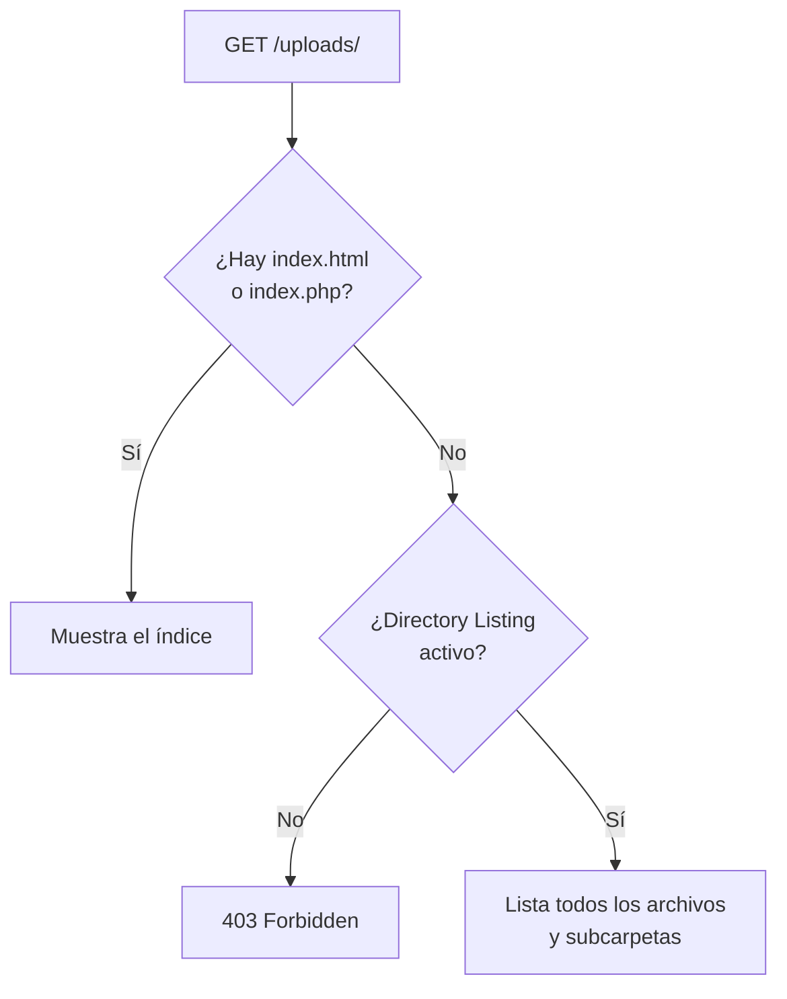

# Objetivo 3: Peligros del "Directory Listing"

## Descripción

El Directory Listing es una función del servidor web que muestra el contenido de una carpeta cuando no hay una página para mostrar. Está pensado para compartir archivos de forma simple, pero en un sitio en producción casi siempre es un error de configuración. OWASP lo incluye dentro de *A05:2021 Security Misconfiguration* y el CWE que lo describe es CWE-548 (*Exposure of Information Through Directory Listing*).

## Desarrollo

### ¿Qué pasa cuando está activo?

Cuando el navegador pide una carpeta, por ejemplo `https://sitio.com/uploads/`, el servidor busca adentro un archivo índice. Cuáles busca depende de la configuración: en Apache es la directiva `DirectoryIndex` y en Nginx la directiva `index`, y normalmente son `index.html` o `index.php`.

Si encuentra uno, lo muestra y el usuario ni se entera de qué más hay en la carpeta. Si no encuentra ninguno, depende de cómo esté configurado:

- Con el Directory Listing apagado, responde **403 Forbidden**.
- Con el Directory Listing encendido, el servidor arma solo una página HTML con la lista de todo lo que hay en la carpeta.



La página que se genera se ve más o menos así:

```text
Index of /backup

Name                    Last modified      Size
Parent Directory                             -
db_clientes_2024.sql    2024-03-12 10:41   48M
sitio_completo.zip      2024-03-12 10:45  210M
config.php.bak          2024-02-01 09:12   2.1K

Apache/2.4.41 (Ubuntu) Server at sitio.com Port 80
```

Se ven los nombres de los archivos, la fecha en que se modificaron y el tamaño. Cada nombre es un link, así que se puede entrar a las subcarpetas o descargar cualquier archivo con un clic. Además, en Apache el pie de la página muestra la versión del servidor y el sistema operativo, que sirve para buscar CVEs.

En Apache esto lo maneja el módulo `mod_autoindex` y se activa con `Options Indexes`. En Nginx se activa con `autoindex on;` (por defecto viene apagado). En IIS se llama *Directory Browsing*.

### ¿Qué archivos pueden quedar expuestos?

Lo que se expone es cualquier cosa que alguien haya dejado dentro de la carpeta pública del sitio, aunque no haya ningún link que lleve a ella. Los casos más comunes son:

- Backups de la base de datos (`.sql`, `.dump`) o del sitio completo (`.zip`, `.tar.gz`). Un dump de la base puede tener datos de clientes y hashes de contraseñas.
- Copias de archivos de configuración, como `config.php.bak`, `config.old` o `.env`, con usuarios y contraseñas de la base de datos o claves de APIs.
- Versiones viejas del código (`login.php.old`, `index.php~`), que el servidor entrega como texto y dejan leer el código fuente.
- La carpeta `.git`, de la que se puede reconstruir todo el repositorio con su historial.
- Logs de la aplicación, que pueden tener rutas internas, IPs, errores o tokens de sesión.
- Archivos que subieron los usuarios, como facturas, DNIs o currículums en una carpeta `uploads/`.
- Claves privadas o certificados.

Aunque no aparezca nada sensible, el listado igual le muestra al atacante cómo está organizado el sitio: carpetas, nombres de archivos internos y tecnologías. Encima es muy fácil de encontrar. Buscando `intitle:"index of"` en Google aparecen miles de sitios con esta configuración.

Por eso el Directory Listing en sí no suele ser grave. Lo grave es lo que deja a la vista. En un reporte, el CVSS va a depender de qué archivos se encontraron.

### ¿Cómo se mitiga?

Lo principal es apagarlo en el servidor.

En Apache, en la configuración del sitio o en un `.htaccess`:

```apache
<Directory /var/www/html>
    Options -Indexes
</Directory>
```

En Nginx, asegurarse de que no haya ningún `autoindex on;` en la configuración, o dejarlo explícito:

```nginx
location / {
    autoindex off;
}
```

En IIS se desactiva *Directory Browsing* desde el administrador o en el `web.config`.

Además de eso:

- No guardar backups, logs ni archivos de configuración dentro de la carpeta pública del sitio. Si no están ahí, no se pueden descargar aunque el listado esté activo.
- Bloquear el acceso a archivos ocultos (`.git`, `.env`) y a extensiones como `.bak`, `.old` o `.sql`.
- Ocultar la versión del servidor (`ServerTokens Prod` y `ServerSignature Off` en Apache, `server_tokens off;` en Nginx).
- Incluir esta revisión en los controles antes de pasar a producción, o escanearlo con herramientas como Nikto o Nuclei, que lo detectan.

Poner un `index.html` vacío en cada carpeta también evita el listado, pero es un parche: alcanza con olvidarse de una carpeta para que vuelva a aparecer.

## Conclusiones

El Directory Listing aparece cuando una carpeta no tiene archivo índice y el servidor está configurado para mostrar su contenido. Es un error de configuración simple, pero convierte cualquier archivo olvidado en la carpeta pública en algo que cualquiera puede descargar, desde un backup de la base de datos hasta un `.env` con contraseñas.

La solución es apagarlo en el servidor (`Options -Indexes` en Apache, `autoindex off` en Nginx) y no dejar archivos sensibles dentro del sitio, porque si están ahí, igual se pueden descargar por otro lado si alguien adivina el nombre.
