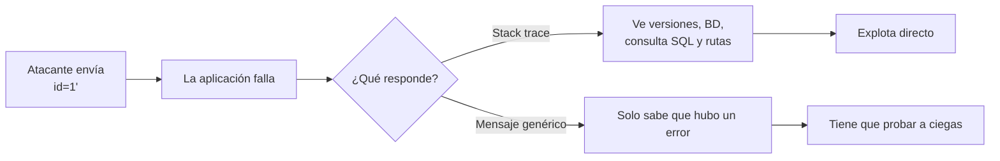

# Objetivo 4: Manejo Inseguro de Errores (Stack Traces)

## Descripción

Todas las aplicaciones fallan en algún momento. Lo importante es qué le muestran al usuario cuando eso pasa. Si en producción se ve el detalle técnico del error, la aplicación le está dando al atacante información que de otra forma le costaría mucho conseguir. Esto entra en *A05:2021 Security Misconfiguration* y el CWE es CWE-209 (*Generation of Error Message Containing Sensitive Information*).

## Desarrollo

### Mensaje genérico vs. Stack Trace

Un **mensaje de error genérico** le avisa al usuario que algo salió mal, sin explicar por qué. Por ejemplo:

```text
Ocurrió un error inesperado. Intentá de nuevo más tarde.
Código de referencia: 7f3a-91c2
```

El código de referencia sirve para que soporte pueda buscar el error en los logs, pero al usuario no le dice nada sobre cómo funciona la aplicación por dentro.

Un **stack trace** (traza de la pila) es el registro de las funciones que se estaban ejecutando cuando ocurrió el error, en orden, desde donde explotó hasta el punto de entrada. Es muy útil para que un desarrollador encuentre el problema. El inconveniente aparece cuando se muestra en la respuesta HTTP de producción, como este ejemplo de una aplicación Python:

```text
Traceback (most recent call last):
  File "/home/deploy/tienda/venv/lib/python3.8/site-packages/flask/app.py", line 2077, in wsgi_app
  File "/home/deploy/tienda/app/routes/productos.py", line 42, in detalle
    cursor.execute("SELECT nombre, precio FROM productos WHERE id = " + id)
psycopg2.errors.SyntaxError: syntax error at or near "'"
LINE 1: SELECT nombre, precio FROM productos WHERE id = 1'
```

Un error así puede aparecer con solo agregar una comilla al `id` en la URL.

### ¿Qué le sirve al atacante?

Con ese pedazo de texto, el atacante ya sabe:

- **El lenguaje, el framework y sus versiones:** Python 3.8 y Flask. Con eso puede buscar CVEs conocidos para esas versiones, como vi en el tema anterior.
- **La base de datos:** `psycopg2` indica PostgreSQL. Ya sabe qué sintaxis usar en las inyecciones.
- **La consulta SQL completa:** se ve que el `id` se concatena directamente en la consulta. Eso confirma que hay un SQL Injection, y además le muestra los nombres de la tabla y las columnas.
- **Rutas internas:** `/home/deploy/tienda/` le dice el usuario del sistema y dónde está instalada la aplicación. Le sirve si después encuentra un *path traversal* o una forma de subir archivos.
- **La estructura del código:** nombres de archivos, funciones y número de línea.

Sin el stack trace, el atacante tendría que deducir todo eso a prueba y error, mandando muchas peticiones y mirando cambios chicos en las respuestas. Con el stack trace lo obtiene en una sola petición, y además sin hacer ruido.

Hay casos todavía peores. Algunos frameworks tienen un **modo debug** que, además del error, muestra variables de entorno, configuración, cookies o incluso una consola para ejecutar código:

- **Django** con `DEBUG = True` muestra una página con la configuración del proyecto, las rutas disponibles y los datos de la petición.
- **Flask/Werkzeug** con el debugger activo ofrece una consola de Python en el navegador. Si se consigue el PIN, es ejecución remota de código directa.
- **Laravel** con `APP_DEBUG=true` muestra variables de entorno, y algunas versiones de su página de errores (Ignition) tenían una vulnerabilidad de ejecución remota de código: CVE-2021-3129.

Además, aunque el error no muestre nada, la sola diferencia entre "la página dio error" y "la página funcionó" ya le sirve al atacante como pista, por ejemplo para un SQL Injection a ciegas. Por eso conviene que los errores se vean siempre iguales.



### ¿Cómo se hace bien?

La idea es separar lo que ve el usuario de lo que queda registrado:

- Al usuario, un mensaje genérico con un código de referencia, siempre con la misma forma.
- En los logs del servidor, el stack trace completo asociado a ese código, para que el equipo lo pueda investigar.

En la práctica:

- Desactivar el modo debug en producción (`DEBUG = False` en Django, `APP_DEBUG=false` en Laravel, nunca `debug=True` en Flask).
- Configurar páginas de error propias para 404 y 500, tanto en la aplicación como en el servidor web.
- Tener un manejador global de excepciones que atrape cualquier error que no se haya contemplado. Por ejemplo, en Flask:

```python
@app.errorhandler(Exception)
def error_generico(e):
    ref = uuid.uuid4().hex[:8]
    app.logger.exception("Error %s", ref)  # el detalle queda en el log
    return {"error": "Ocurrió un error inesperado", "ref": ref}, 500
```

- Revisar que los logs no queden en una carpeta pública del sitio, porque ahí se volvería a filtrar la misma información (lo mismo que vimos con el Directory Listing).

Ocultar el error no arregla la falla de fondo. En el ejemplo, el SQL Injection sigue estando y hay que corregirlo usando consultas parametrizadas. Lo que se logra es no regalarle al atacante el mapa para explotarla.

## Conclusiones

El mensaje genérico le avisa al usuario que algo falló. El stack trace le explica al atacante cómo está hecha la aplicación por dentro: qué tecnologías y versiones usa, qué base de datos tiene, cómo arma sus consultas y dónde están los archivos. Es información que acorta mucho la etapa de reconocimiento y que muchas veces confirma una vulnerabilidad en una sola petición.

Por eso el detalle de los errores tiene que quedar en los logs del servidor y nunca en la respuesta HTTP de producción. Y el modo debug de cualquier framework tiene que estar siempre apagado fuera del entorno de desarrollo.
