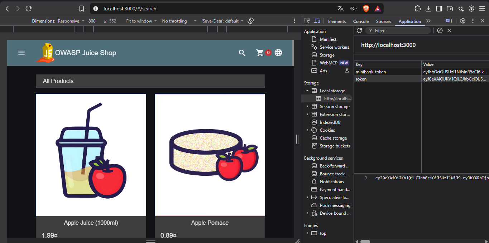

# Objetivo 2: Ingeniería Inversa a JSON Web Tokens (JWT)

## Descripción

Un JWT tiene tres partes separadas por puntos: header, payload y firma. El header y el payload son JSON codificado en Base64URL, que no es un cifrado, así que cualquiera que tenga el token los puede leer. Lo que evita que alguien cambie el contenido es la firma.

Para no usar un token de una cuenta real, usé OWASP Juice Shop, una tienda online hecha con vulnerabilidades a propósito para practicar, que maneja la sesión con JWT.

### De dónde saqué el token

Levanté Juice Shop en mi computadora con Docker:

```powershell
docker run --rm -p 3000:3000 bkimminich/juice-shop
```

Después entré a `http://localhost:3000`, me registré con un usuario de prueba (`prueba@test.com`) e inicié sesión. Cuando iniciás sesión, el servidor devuelve el JWT y la página lo guarda en el navegador. Lo encontré con F12, en Application > Local storage > `http://localhost:3000`, con el nombre `token`. También se guarda como cookie y se manda en la cabecera `Authorization: Bearer` cuando la página llama a la API.



Este es el token completo:

```text
eyJ0eXAiOiJKV1QiLCJhbGciOiJSUzI1NiJ9.eyJkYXRhIjp7ImlkIjoyNiwidXNlcm5hbWUiOiIiLCJlbWFpbCI6InBydWViYUB0ZXN0LmNvbSIsInBhc3N3b3JkIjoiN2ZjMDcyYjE2OGNmNzMxNWY3ODBkMmViYzY1NGFkOWQiLCJyb2xlIjoiY3VzdG9tZXIiLCJkZWx1eGVUb2tlbiI6IiIsImxhc3RMb2dpbklwIjoiMC4wLjAuMCIsInByb2ZpbGVJbWFnZSI6Ii9hc3NldHMvcHVibGljL2ltYWdlcy91cGxvYWRzL2RlZmF1bHQuc3ZnIiwidG90cFNlY3JldCI6IiIsImlzQWN0aXZlIjp0cnVlLCJjcmVhdGVkQXQiOiIyMDI2LTExLTEyIDE3OjExOjUwLjMxOCArMDA6MDAiLCJ1cGRhdGVkQXQiOiIyMDI2LTExLTEyIDE3OjExOjUwLjMxOCArMDA6MDAiLCJkZWxldGVkQXQiOm51bGx9LCJiaWQiOjYsImlhdCI6MTc5NDUwMzU1MH0.uYaMAvp0d4iCXBYqaAgc0RgtihVq2uDlPVyW-Qk_DPMAGS-TPB0NjzlF7HEOm9CBD53NfLoCTICar7OZlDE80D50JMVhvxJjXMolw9ODhSXdVn5kXml9C1DkNYsjDFK7xx8fBg7v36riGtb5xEoAmcKK_Npq_GSjRhTKAplUsPE
```

Lo dejo completo porque es de una cuenta de prueba en una tienda que corre en mi computadora. Si fuera de una sesión real no lo publicaría, porque con el token cualquiera puede entrar a la cuenta.

## Desarrollo

### Decodificación

Lo decodifiqué desde la terminal con un script corto de PowerShell, en vez de usar jwt.io, para no pegar el token en una página externa. El script separa el token por los puntos y pasa el header y el payload de Base64URL a texto.

### Header

```json
{"typ": "JWT", "alg": "RS256"}
```

El token se firma con `RS256`, que es RSA con SHA-256. Es asimétrico: el servidor firma con su clave privada y el token se verifica con la clave pública, así que para comprobar la firma no hace falta conocer la clave con la que se firmó.

La firma tiene 128 bytes, o sea que la clave RSA es de 1024 bits. Hoy lo recomendado es usar 2048 como mínimo.

### Payload

```json
{
  "data": {
    "id": 26,
    "username": "",
    "email": "prueba@test.com",
    "password": "7fc072b168cf7315f780d2ebc654ad9d",
    "role": "customer",
    "deluxeToken": "",
    "lastLoginIp": "0.0.0.0",
    "profileImage": "/assets/public/images/uploads/default.svg",
    "totpSecret": "",
    "isActive": true,
    "createdAt": "2026-11-12 17:11:50.318 +00:00",
    "updatedAt": "2026-11-12 17:11:50.318 +00:00",
    "deletedAt": null
  },
  "bid": 6,
  "iat": 1794503550
}
```

| Campo | Valor | Qué es |
| --- | --- | --- |
| `data.id` | `26` | ID del usuario en la base de datos |
| `data.email` | `prueba@test.com` | Email de la cuenta |
| `data.password` | `7fc072b1...ad9d` | Hash MD5 de la contraseña |
| `data.role` | `customer` | Rol del usuario |
| `data.totpSecret` | vacío | Secreto del segundo factor (2FA) |
| `data.deluxeToken` | vacío | Token de la membresía paga de la tienda |
| `data.lastLoginIp` | `0.0.0.0` | Última IP desde la que se inició sesión |
| `bid` | `6` | ID del carrito de compras |
| `iat` | `1794503550` | Fecha de emisión: 12/11/2026, 14:12 (hora Argentina) |

### Datos sensibles y roles

Lo que más me llamó la atención es que el servidor puso en el token todos los datos del usuario tal como están en la base de datos, y todo eso se puede leer sin ninguna clave.

Está el hash de la contraseña. Por el formato (32 caracteres hexadecimales) es MD5, y no tiene salt. MD5 se calcula muy rápido y hay tablas con millones de contraseñas ya calculadas, así que si la contraseña es débil se puede sacar en segundos. El hash no debería salir nunca de la base de datos.

También está el rol, `customer`. Con eso se ve que el sistema decide los permisos según ese campo. Juice Shop además tiene un rol `admin`, así que si alguien encuentra la forma de falsificar el token, por ejemplo con el ataque del algoritmo `none` del Objetivo 4, ya sabe qué valor poner.

El campo `totpSecret` está vacío porque no activé el 2FA, pero si lo activara, el secreto viajaría en el token. Con ese secreto se pueden generar los códigos del segundo factor, así que el 2FA dejaría de servir para algo.

El resto son datos personales y de uso: el email, la última IP, las fechas de creación y modificación de la cuenta, el ID del usuario y el ID del carrito. Con los IDs se podría probar si se puede ver el carrito o el perfil de otro usuario cambiando el número en las peticiones (IDOR).

Por último, el token no tiene el campo `exp`, que es la fecha de vencimiento. Si alguien lo roba, el token en sí no dice hasta cuándo sirve.

## Conclusiones

El algoritmo de firma está bien elegido, aunque la clave de 1024 bits es corta para lo que se usa hoy. El problema está en el payload: en lugar de tener solo lo necesario para identificar la sesión, tiene todos los datos del usuario, incluido el hash MD5 de la contraseña y el lugar donde iría el secreto del 2FA. Y no tiene fecha de vencimiento.

La firma sirve para que nadie pueda cambiar el contenido del token, pero no lo esconde. Por eso en el payload debería ir solo el ID del usuario, el rol y el vencimiento, y el resto de los datos tendría que quedar en el servidor.
