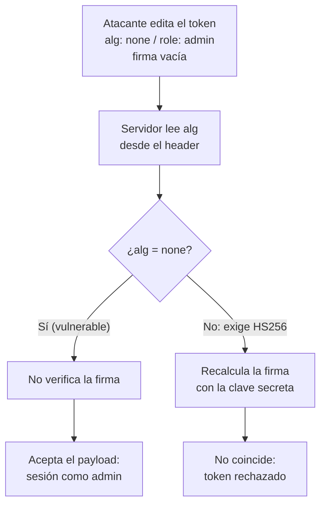

# Objetivo 4: Análisis del Ataque de Algoritmo "None"

## Descripción

El ataque del algoritmo `none` se aprovecha de un servidor que acepta JWT sin firma. Si el backend lo permite, alguien puede armar un token con el usuario y el rol que quiera, y el servidor lo toma como válido aunque no conozca la clave secreta. El CWE que lo describe es CWE-347 (*Improper Verification of Cryptographic Signature*) y entra en *A07:2021 Identification and Authentication Failures*.

## Desarrollo

### Cómo se verifica un JWT normalmente

Un JWT tiene tres partes: `header.payload.firma`. Por ejemplo:

```text
eyJhbGciOiJIUzI1NiIsInR5cCI6IkpXVCJ9.eyJzdWIiOiIxMDQyIiwidXNlcm5hbWUiOiJ1c3VhcmlvIiwicm9sZSI6InVzZXIifQ.<firma>
```

Decodificado:

```json
// Header
{"alg": "HS256", "typ": "JWT"}

// Payload
{"sub": "1042", "username": "usuario", "role": "user"}
```

La firma se calcula sobre el header y el payload con la clave secreta del servidor:

```text
firma = HMAC-SHA256(clave_secreta, base64url(header) + "." + base64url(payload))
```

Cuando el token vuelve al servidor, este calcula la firma de nuevo con su clave y la compara con la que trae el token. Si alguien cambió `"role": "user"` por `"role": "admin"`, las firmas no coinciden y el token se rechaza. El que modificó el payload no puede calcular una firma válida porque no tiene la clave.

El header y el payload se pueden leer y editar con cualquier herramienta, así que toda la seguridad del token depende de este paso.

### Qué es el algoritmo "none"

La especificación de JWT (RFC 7518, sección 3.6) permite poner `"alg": "none"` para tokens sin protección: no llevan firma y la tercera parte queda vacía. Está pensado para casos donde la integridad ya se garantiza de otra forma, no para autenticar usuarios.

El problema es quién decide el algoritmo. El campo `alg` viene dentro del token, así que lo controla quien lo manda. Una implementación vulnerable lee el algoritmo del header y verifica según lo que diga ahí:

```javascript
function verificar(token, clave) {
  const [h, p, firma] = token.split(".");
  const header = JSON.parse(base64urlDecode(h));

  if (header.alg === "none") {
    return JSON.parse(base64urlDecode(p));   // no hay nada que verificar
  }
  if (header.alg === "HS256") {
    if (firma !== hmacSha256(clave, h + "." + p)) throw new Error("Firma inválida");
    return JSON.parse(base64urlDecode(p));
  }
}
```

Si el token dice `alg: none`, la parte que comprueba la firma nunca se ejecuta y el servidor termina confiando en un token que le pide que no lo verifique.

No es solo algo teórico: varias librerías de JWT venían así de fábrica. Por ejemplo, `jsonwebtoken` de Node.js antes de la versión 4.2.2 (CVE-2015-9235).

### Cómo se falsifica una identidad

Alcanza con tener un token propio válido para conocer el formato, y después:

1. Cambiar el header para que diga que no hay firma:

   ```json
   {"alg": "none", "typ": "JWT"}
   ```

2. Cambiar el payload por la identidad que quiere suplantar:

   ```json
   {"sub": "1", "username": "admin", "role": "admin"}
   ```

3. Codificar las dos partes en Base64URL y dejar la firma vacía, pero conservando el punto final:

   ```text
   eyJhbGciOiJub25lIiwidHlwIjoiSldUIn0.eyJzdWIiOiIxIiwidXNlcm5hbWUiOiJhZG1pbiIsInJvbGUiOiJhZG1pbiJ9.
   ```

4. Mandar ese token en lugar del suyo, por ejemplo en `Authorization: Bearer ...` o en la cookie de sesión.

El servidor vulnerable lee `alg: none`, no verifica nada y da el payload por válido. A partir de ahí, para la aplicación esa persona es el usuario `admin`.



### Por qué no hace falta la clave secreta

La clave secreta solo se usa para calcular y comprobar la firma. Si el servidor acepta tokens sin firma, la clave nunca se usa. No hay que romperla ni adivinarla: directamente se la saltea.

Por eso es un ataque tan grave. No hace falta fuerza bruta ni saber criptografía, solo editar dos JSON y codificarlos. Permite hacerse pasar por cualquier usuario y ponerse cualquier rol, cambiando el `sub` o el `role` del payload. Y como las peticiones se ven normales, al servidor le cuesta detectarlo.

Algunos backends intentan taparlo rechazando el texto exacto `"none"`, pero si la comparación distingue mayúsculas de minúsculas, se puede esquivar con `"None"`, `"NONE"` o `"nOnE"`. Por eso una lista negra no alcanza.

### Cómo se previene

La idea de fondo es que el algoritmo lo fije el servidor y no el token. La verificación tiene que trabajar con una lista fija de algoritmos permitidos e ignorar el `alg` que venga en el header. Por ejemplo, en Python con PyJWT:

```python
datos = jwt.decode(token, CLAVE, algorithms=["HS256"])
```

Si el token dice `none`, o cualquier otro algoritmo que no esté en la lista, `decode` lo rechaza.

Además de eso, conviene rechazar siempre los tokens sin firma o con la tercera parte vacía, usar librerías mantenidas en vez de escribir la verificación a mano, y no confundir leer un token con validarlo. Varias librerías tienen una función que decodifica el token sin comprobar la firma (como `jwt.decode()` en `jsonwebtoken` de Node.js), y esa función no sirve para decidir si alguien tiene acceso.

El mismo descuido de confiar en el `alg` del token habilita otro ataque parecido, la confusión de algoritmos. Si el servidor usa `RS256` y se cambia el header a `HS256`, algunas implementaciones verifican la firma HMAC usando la clave pública como si fuera la secreta. Como la clave pública la puede tener cualquiera, se pueden firmar tokens válidos. La solución es la misma: fijar el algoritmo en el servidor.

## Conclusiones

Un JWT solo sirve si el servidor verifica la firma. El ataque del algoritmo `none` funciona porque el dato que dice cómo verificar el token está dentro del propio token, y un backend vulnerable le hace caso. Se declara que el token no tiene firma, el servidor saltea la verificación y la clave secreta, que era lo único que lo protegía, deja de importar.

Con eso se puede falsificar cualquier identidad editando un JSON. La corrección es simple: el servidor tiene que decir qué algoritmos acepta y rechazar el resto, incluido `none`.
