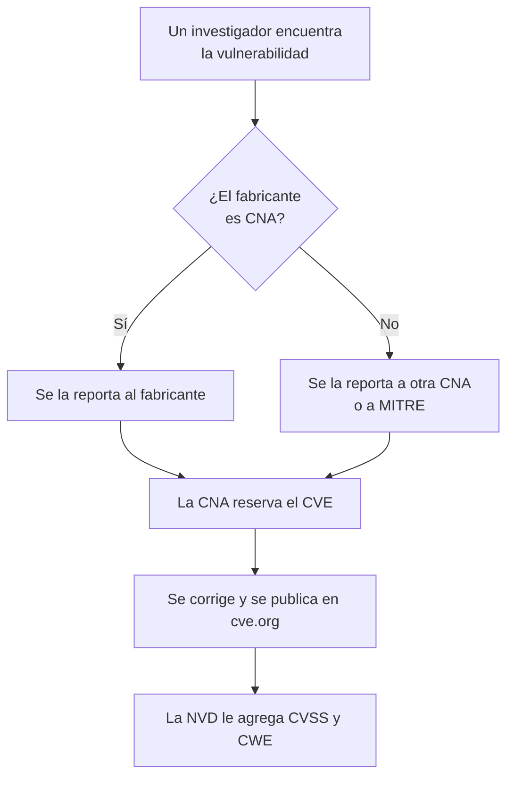

# Objetivo 1: Estandarización de Vulnerabilidades (CVE y CWE)

## Descripción

Cuando se encuentra una vulnerabilidad, todos los que intervienen (el fabricante, quien la tiene que parchear, las herramientas de escaneo) necesitan llamarla de la misma forma. Para eso se usan dos estándares que mantiene MITRE: CVE y CWE.

## Desarrollo

### CVE

Un **CVE** (*Common Vulnerabilities and Exposures*) es un identificador para una vulnerabilidad puntual de un producto y una versión concretos. Funciona como un DNI: cualquiera que diga "CVE-2021-44228" está hablando exactamente de la misma falla.

El formato es `CVE-AÑO-NÚMERO`. El año es cuando se reservó el identificador y el número es secuencial, de cuatro dígitos o más. El ejemplo de arriba es Log4Shell, una ejecución remota de código en la librería Apache Log4j 2.

Cada registro trae una descripción corta, los productos y versiones afectados y links a los avisos o parches. El score de severidad (CVSS) no viene en el CVE: normalmente lo agrega el fabricante o la NVD.

### CWE

El **CWE** (*Common Weakness Enumeration*) es un catálogo de tipos de debilidades. No habla de ningún producto, sino del error de programación o de diseño que permite que exista una vulnerabilidad. Algunos que aparecen seguido en aplicaciones web:

| CWE | Debilidad |
| --- | --- |
| CWE-79 | Cross-site Scripting (XSS) |
| CWE-89 | SQL Injection |
| CWE-352 | Cross-Site Request Forgery (CSRF) |
| CWE-639 | Acceso a datos de otro usuario cambiando un identificador (IDOR) |

MITRE publica además todos los años el CWE Top 25, con las debilidades más frecuentes y peligrosas.

### ¿En qué se diferencian?

El CWE es el tipo de error y el CVE es un caso real de ese error en un producto. Por ejemplo, CWE-89 es "SQL Injection" en general, mientras que un CVE sería "SQL Injection en el plugin X de WordPress, versión 2.3".

Por eso un mismo CWE puede estar detrás de miles de CVEs. También pasa al revés: la NVD asocia Log4Shell a varios CWE, entre ellos CWE-502 (deserialización de datos no confiables) y CWE-917 (inyección en lenguaje de expresiones).

El CWE sirve más para prevenir, porque explica qué se hizo mal al programar. El CVE sirve para saber si un sistema está afectado y qué parche aplicar.

### ¿Quién asigna los CVE?

Los asignan las **CNAs** (*CVE Numbering Authorities*), organizaciones autorizadas por el programa CVE para hacerlo dentro de su propio alcance. Hoy son más de 400. La mayoría son fabricantes que asignan CVEs a sus propios productos, como Microsoft, Google, Apple, Cisco o Red Hat. También hay CNAs que son proyectos open source (Apache), plataformas como GitHub y HackerOne, CERTs nacionales y empresas de seguridad como Tenable o Wordfence.

Arriba de todas están MITRE y CISA, que coordinan el programa. Si un producto no tiene ninguna CNA que lo cubra, el CVE se le pide a MITRE, que funciona como "CNA de último recurso".



### ¿Dónde se consultan?

El registro oficial está en [cve.org](https://www.cve.org). La consulta más completa suele ser en la [NVD](https://nvd.nist.gov) del NIST, porque a cada CVE le suma el score CVSS, el CWE y la lista de productos afectados. Los CWE se buscan en [cwe.mitre.org](https://cwe.mitre.org).

También me pareció útil el catálogo [KEV de CISA](https://www.cisa.gov/known-exploited-vulnerabilities-catalog), que lista los CVE que se sabe que se están explotando. Sirve mucho para decidir qué parchear primero.

### Herramientas que detectan CVEs

Estas herramientas identifican qué software y versión corre en un sistema y lo comparan con las bases de CVEs conocidos:

- **Nessus** (Tenable): escáner comercial de vulnerabilidades de red. Cada hallazgo muestra su CVE y su CVSS.
- **OpenVAS / Greenbone**: la alternativa open source a Nessus.
- **Nuclei**: escáner con templates, muchos escritos para un CVE puntual. Se usa bastante en aplicaciones web.
- **Nmap** con el script `vulners`: toma las versiones que detecta `-sV` y busca sus CVEs. Es el mismo Nmap que usé en el Módulo I:

```bash
nmap -sV --script vulners <objetivo_autorizado>
```

Igual, todas estas herramientas encuentran solo lo que ya es conocido. Una falla en la lógica de una aplicación hecha a medida, como un IDOR, no tiene CVE y hay que buscarla a mano.

## Conclusiones

CVE y CWE se complementan: el CWE dice qué tipo de error se cometió y el CVE identifica un caso real en un producto. Gracias a las CNAs cada vulnerabilidad pública tiene un único nombre, y cualquiera puede consultarlo en cve.org o en la NVD.

Para mis reportes, la idea es que cada hallazgo lleve siempre su CWE, y también su CVE cuando la falla está en un producto conocido. En aplicaciones propias del cliente casi nunca va a haber CVE, pero con el CWE alcanza para que se entienda qué tipo de problema es.
