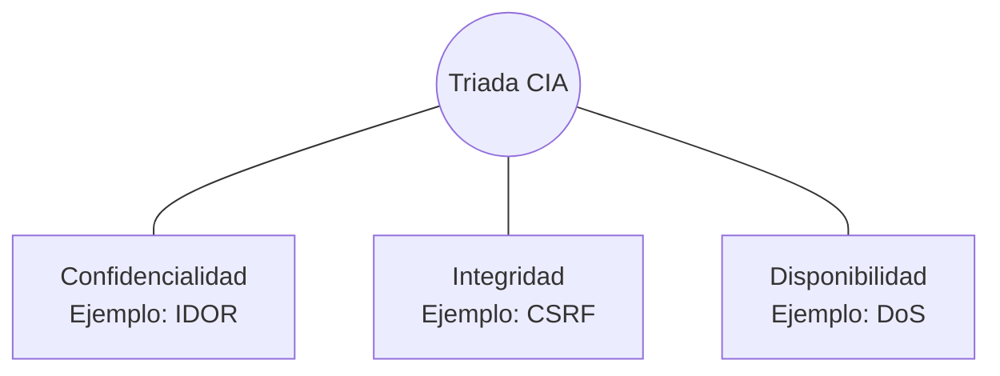

# Objetivo 2: Análisis de la Triada CIA

## Descripción

La triada CIA (*Confidentiality, Integrity, Availability*) son los tres pilares que la seguridad de la información intenta proteger. Cualquier ataque se puede explicar según qué pilar o pilares rompe.



## Desarrollo

### Los tres pilares

**Confidencialidad** es que la información la pueda ver solo quien tiene permiso. Se pierde cuando alguien lee algo que no le corresponde, aunque no lo toque. Se cuida con autenticación, controles de acceso y cifrado.

**Integridad** es que la información sea correcta y que nadie la cambie sin autorización. Se pierde cuando un dato se modifica, se agrega o se borra sin que el dueño lo haya decidido. Se cuida validando del lado del servidor quién puede modificar qué, y con firmas, hashes y registros de auditoría.

**Disponibilidad** es que el sistema funcione cuando los usuarios lo necesitan. Se pierde cuando el servicio se cae o se pone tan lento que no se puede usar. Se cuida con redundancia, límites de uso, CDNs y backups.

### Un ataque para cada pilar

#### Confidencialidad: IDOR

Un IDOR pasa cuando la aplicación usa un identificador que maneja el usuario, como el `id` de la URL, y no revisa que el recurso sea suyo.

Por ejemplo, un usuario ve su compra en `/ventas/?id=15`, cambia el número a 16 y la aplicación le muestra la compra de otra persona, con su nombre y su dirección. Es el mismo parámetro que estuve probando en el laboratorio Ventas.

El atacante solo lee datos ajenos, no los cambia ni afecta el servicio. Por eso lo que se rompe es la confidencialidad.

#### Integridad: CSRF

En un CSRF, el atacante consigue que el navegador de la víctima mande una petición a una página donde la víctima ya tiene la sesión iniciada. Como el navegador agrega las cookies solo, la aplicación cree que la pidió el usuario.

Por ejemplo, la víctima entra a una página del atacante que tiene escondido este formulario, que se envía solo:

```html
<form action="https://tienda.ejemplo/cuenta/email" method="POST">
  <input type="hidden" name="email" value="atacante@ejemplo.com">
</form>
<script>document.forms[0].submit();</script>
```

El email de la cuenta de la víctima pasa a ser el del atacante. Lo interesante es que el atacante no puede leer la respuesta, porque el navegador no se lo permite. No roba información, la modifica, así que lo que se rompe es la integridad.

#### Disponibilidad: Denegación de servicio (DoS)

Un DoS busca que el servicio deje de responder a los usuarios reales, agotando sus recursos.

Un ejemplo es el ataque Slowloris: abre cientos de conexiones con el servidor web y las mantiene vivas mandando los encabezados de a poquito, sin terminar nunca la petición. El servidor se queda sin conexiones libres y empieza a rechazar a todos los demás. Cuando el ataque viene de muchas máquinas a la vez se llama DDoS.

Acá no se lee ni se cambia ningún dato, simplemente nadie puede usar el sistema. Por esto mismo, en el escaneo del Módulo I tuve que bajar la velocidad de Nmap: los programas de bug bounty no permiten pruebas que puedan afectar el servicio.

### La triada en CVSS

En CVSS 3.1 el impacto de una vulnerabilidad se mide justamente con estos tres pilares. Hay una métrica para cada uno (C, I y A) y cada una puede valer *None*, *Low* o *High*. Con los ejemplos de arriba, el IDOR puntuaría en C, el CSRF en I y el DoS en A, y los otros dos pilares quedarían en *None*.

## Conclusiones

Los tres pilares se pueden romper por separado. El IDOR expone información sin cambiarla, el CSRF la cambia sin exponerla y el DoS no la toca pero impide usarla.

Igual, en la práctica muchos ataques afectan a más de uno a la vez. Un SQL Injection, por ejemplo, puede leer, modificar y borrar datos. Por eso, al reportar una vulnerabilidad conviene pensar el impacto en cada pilar por separado, que es lo mismo que pide CVSS.
