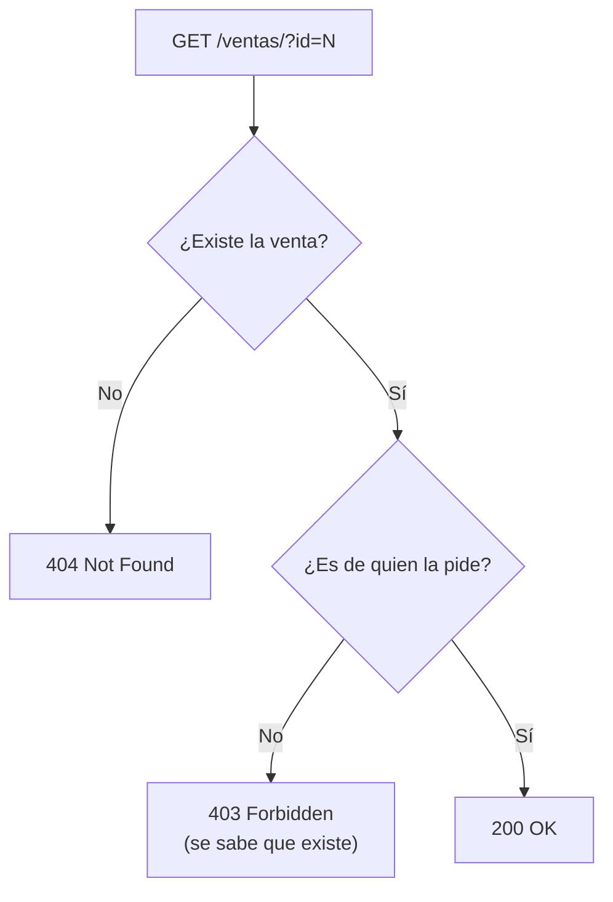
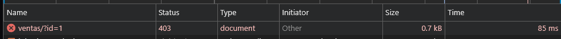
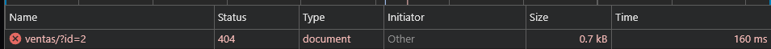

# Objetivo 4: Primer Reporte Técnico Oficial

## Descripción

Para probar la [plantilla del Objetivo 3](../Objetivo_3_Plantilla_Base_de_Reporte/plantilla_reporte.md) elegí el laboratorio Ventas, el mismo que usé en el [Mapeo Lógico del Módulo I](../../Modulo_I_Introducción_al_Pentesting_Web_y_Arquitectura_HTTP/Objetivo_1_Mapeo_Logico/objetivo_1_mapeo_logico.md). Ahí había visto que, cambiando el `id` de la URL, a veces el servidor respondía 403 y otras veces 404. Esa diferencia es la vulnerabilidad que reporto a continuación, como si se la entregara a un cliente.

---

# Hallazgo de Seguridad: Enumeración de ventas mediante el parámetro `id` (IDOR)

| Campo | Valor |
| --- | --- |
| Nombre | Enumeración de ventas de otros vendedores mediante el parámetro `id` (IDOR) |
| Categoría | A01:2021 Broken Access Control / CWE-204: Observable Response Discrepancy |
| Versión | N/A (No Aplica) |
| Vector CVSS | 5.3 (Media) - `CVSS:3.1/AV:N/AC:L/PR:N/UI:N/S:U/C:L/I:N/A:N` |
| URL afectada(s) | `GET https://ventas.softwareseguro.com.ar/ventas/?id={id}` |

## Descripción

Cualquier persona, sin tener cuenta, puede saber cuántas ventas tiene cada vendedor de la plataforma. No se llega a ver el contenido de las ventas, pero alcanza con ir cambiando un número en la dirección de la página para contarlas. Es información comercial que le sirve a la competencia para conocer el volumen de negocio de otro vendedor y ver cómo cambia con el tiempo. Como es muy fácil de aprovechar, recomiendo corregirlo en el corto plazo.

## Detalles de la vulnerabilidad

La página de detalle de una venta recibe el número de venta en el parámetro `id` (`/ventas/?id=1`). Esos números son consecutivos, y el servidor responde distinto según el caso:

| Caso | Respuesta |
| --- | --- |
| La venta es de quien la pide | `200 OK` con el detalle |
| La venta existe pero es de otro | `403 Forbidden` |
| La venta no existe | `404 Not Found` |

El control de acceso funciona, porque no deja ver ventas ajenas. El problema es que el backend primero busca la venta y después revisa de quién es, y en cada caso devuelve un código diferente. Entonces, un 403 confirma que esa venta existe aunque no se pueda abrir.



Como los números son consecutivos, recorrerlos todos es muy fácil, y contando los 403 se obtiene la cantidad de ventas de los demás. Si se repite cada tanto, también se puede ver cuántas ventas nuevas van haciendo.

Lo clasifico como IDOR porque el acceso depende de un identificador que controla el usuario. Como lo que se filtra es la existencia de la venta y no sus datos, el CWE que mejor lo describe es CWE-204 (la aplicación responde de forma distinta y eso revela información).

**Justificación del CVSS:**

| AV | AC | PR | UI | S | C | I | A |
| --- | --- | --- | --- | --- | --- | --- | --- |
| N | L | N | N | U | L | N | N |

- Se ataca por internet (AV:N), sin ninguna condición especial (AC:L) y sin necesidad de iniciar sesión (PR:N). No hace falta que otra persona haga nada (UI:N), y el impacto queda dentro de la misma aplicación (S:U).
- La confidencialidad queda en Low porque se filtra cuántas ventas hay, pero no su contenido. Si se pudiera ver el detalle sería High.
- No se modifica nada ni se afecta el servicio, así que integridad y disponibilidad quedan en None.

Lo calculé con la [calculadora de FIRST para CVSS 3.1](https://www.first.org/cvss/calculator/3.1#CVSS:3.1/AV:N/AC:L/PR:N/UI:N/S:U/C:L/I:N/A:N).

## Cómo se detectó

**Requisitos:** solo un navegador con las herramientas de desarrollador abiertas en la pestaña *Network*, para ver el código de cada respuesta. No hace falta cuenta.

1. Sin iniciar sesión, abrir las herramientas de desarrollador (F12) en la pestaña *Network*.
2. Entrar a `https://ventas.softwareseguro.com.ar/ventas/?id=1`. Responde 403: la venta existe pero no es nuestra.
3. Cambiar a `id=2`. Responde 404: esa venta no existe.
4. Seguir subiendo el `id` de a uno y anotar qué devuelve cada uno.
5. Cuando aparecen muchos 404 seguidos, se llegó al final de las ventas existentes.
6. La cantidad de 403 es la cantidad de ventas de otros vendedores.

La petición es siempre la misma y solo cambia el `id`:

```http
GET /ventas/?id=1 HTTP/1.1
Host: ventas.softwareseguro.com.ar
```

Para hacerlo más rápido, se puede usar un loop con `curl` que muestra el código de respuesta de cada `id`:

```bash
for id in $(seq 1 50); do
  code=$(curl -s -o /dev/null -w "%{http_code}" \
    "https://ventas.softwareseguro.com.ar/ventas/?id=$id")
  echo "id=$id -> $code"
done
```

**Resultado esperado:** si la venta no es de quien la pide, la respuesta debería ser la misma exista o no.

**Resultado obtenido:** responde 403 si la venta existe y 404 si no existe, y eso permite contarlas.

## Recomendaciones

1. Responder igual cuando la venta no existe y cuando no es del usuario. La forma más simple es buscar la venta filtrando también por el dueño (`WHERE id = ? AND vendedor_id = ?`) y devolver 404 siempre que no haya resultado.
2. Pedir que el usuario inicie sesión antes de buscar la venta. Hoy la página responde sin autenticación.
3. Usar identificadores aleatorios (por ejemplo UUIDs) en lugar de números consecutivos, para que no se puedan recorrer.
4. Limitar la cantidad de peticiones por IP o por usuario y generar una alerta cuando alguien recibe muchos 403 o 404 seguidos.

**Verificación:** repetir los pasos de "Cómo se detectó", sin sesión y con una cuenta común. Todos los `id` ajenos tienen que dar la misma respuesta.

## Evidencias

Respuesta 403 para `id=1` (la venta existe):



Respuesta 404 para `id=2` (la venta no existe):



---

## Conclusiones

El control de acceso de Ventas funciona y no deja ver ventas ajenas. Aun así, la diferencia entre 403 y 404 alcanza para sacar información del negocio de la competencia. Esto confirma lo que había concluido en el Módulo I: además de rechazar el acceso, importa qué información da el servidor cuando lo rechaza.

Usar la plantilla me ayudó a separar lo que le importa a un directivo (que la competencia puede saber cuánto vendés) de lo que necesita el desarrollador (unificar las respuestas y filtrar por dueño). También me obligó a justificar cada métrica del CVSS. El score quedó en 5.3 (Media): la fuga de información es acotada, pero la puede aprovechar cualquiera sin tener cuenta.
