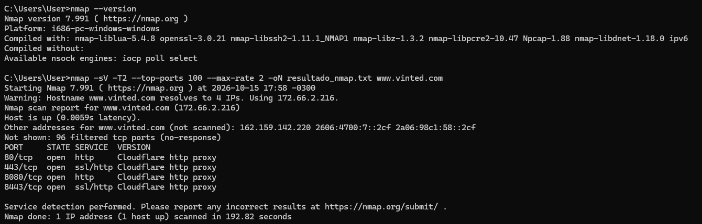

# Objetivo 2: Escaneo de Red (Nmap)

## Descripción

Se realizó un escaneo básico de puertos con **Nmap** sobre un objetivo autorizado dentro de un programa público de bug bounty de **Bugcrowd**: el programa **Vinted Bug Bounty**.

### Objetivo y autorización

El host escaneado fue **`www.vinted.com`**, que figura en el *Primary Target Group* como objetivo **in scope**. El programa aclara que solo se pueden probar los objetivos listados y que cualquier otro subdominio queda fuera de alcance, por lo que se escaneó únicamente ese nombre exacto.

Sobre el uso de herramientas automatizadas, las *Engagement Guidelines* del programa indican:

> *"Researchers must throttle all testing activity to avoid degrading service availability, triggering automated defenses, or negatively impacting other users. Excessive request rates, high-volume scanning, denial-of-service techniques, or other disruptive testing methods are prohibited."*

El programa no prohíbe el escaneo, sino el escaneo **de alto volumen** o que afecte la disponibilidad del servicio. Además, cuenta con una política de **Safe Harbor** que considera autorizada la investigación realizada de acuerdo con sus reglas. Por eso, el escaneo se configuró para ser liviano y se ejecutó una sola vez.

## Desarrollo

### Comando ejecutado

Se utilizó **Nmap 7.991** en Windows, con el driver de captura Npcap 1.88. La captura incluye `nmap --version` para dejar constancia de la versión.

```bash
nmap -sV -T2 --top-ports 100 --max-rate 2 -oN resultado_nmap.txt www.vinted.com
```

| Opción | Función |
| --- | --- |
| `-sV` | Detecta el servicio y la versión que responden en cada puerto abierto. |
| `-T2` | Plantilla de tiempo *polite*: espacia las sondas para no sobrecargar el objetivo. |
| `--top-ports 100` | Escanea solo los 100 puertos TCP más comunes, en lugar de los 1000 por defecto. |
| `--max-rate 2` | Limita el envío a 2 paquetes por segundo como máximo. |
| `-oN resultado_nmap.txt` | Guarda la salida en formato normal en un archivo de texto. |

### Captura de la terminal



La salida completa está en [resultado_nmap.txt](resultado_nmap.txt).

### Resultados obtenidos

- `www.vinted.com` resuelve a **4 direcciones IP** (dos IPv4 y dos IPv6). Nmap escaneó solo la primera, **172.66.2.216**.
- El host respondió con una latencia de **0,0059 s**.
- De los 100 puertos escaneados, **96 aparecieron como `filtered`**: no hubo respuesta, lo que indica que un firewall descarta esos paquetes.
- El escaneo duró **192,82 segundos**, un tiempo coherente con la configuración lenta elegida.

| Puerto | Estado | Servicio | Versión detectada |
| --- | --- | --- | --- |
| 80/tcp | open | http | Cloudflare http proxy |
| 443/tcp | open | ssl/http | Cloudflare http proxy |
| 8080/tcp | open | http | Cloudflare http proxy |
| 8443/tcp | open | ssl/http | Cloudflare http proxy |

## Conclusiones

Los cuatro puertos abiertos corresponden a servicios web: **80 y 8080** para HTTP, y **443 y 8443** para HTTPS (HTTP sobre TLS). En todos los casos, Nmap identificó el servicio como **Cloudflare http proxy**, y la IP escaneada pertenece a un rango de Cloudflare.

Esto muestra que `www.vinted.com` está detrás de la **CDN de Cloudflare**, algo que el propio programa indica con la etiqueta *Cloudflare CDN*. Por lo tanto, el escaneo no llegó al servidor de origen de Vinted, sino al **borde de Cloudflare**: los puertos abiertos son los que Cloudflare expone para cualquier sitio que protege, y el resto de los puertos queda filtrado.

En términos de reconocimiento, el resultado es útil aunque muestre poca superficie:

- La CDN **oculta la IP real del servidor y sus servicios**, lo que reduce lo que un atacante puede descubrir con un escaneo de puertos directo.
- Toda la superficie expuesta es **web**, así que las pruebas siguientes deberían centrarse en la aplicación (HTTP/HTTPS) y no en otros servicios de red.
- Los puertos 8080 y 8443 son puertos alternativos que Cloudflare acepta por defecto. Que estén abiertos no significa que Vinted tenga servicios adicionales en ellos.

Finalmente, el escaneo se limitó a un único host del scope, a un volumen muy bajo y a una sola ejecución, para respetar las reglas del programa y no afectar la disponibilidad del servicio.
