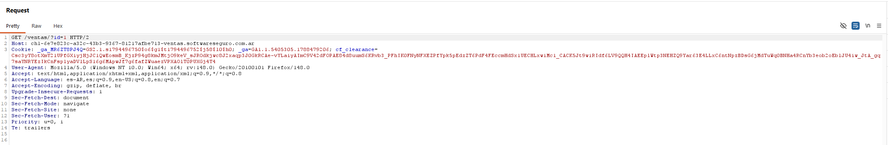

# Objetivo 4: Instalación Proxy

## Descripción

Para los próximos laboratorios necesito poder ver y modificar las peticiones HTTP que manda el navegador. Para eso instalé **Burp Suite Community Edition** y configuré Firefox para que todo su tráfico pase por Burp. Para comprobar que funcionaba, usé el laboratorio **Ventas** de Software Seguro.

## Configuración

### 1. Burp Suite

Burp trae por defecto un proxy escuchando en `127.0.0.1:8080`. Lo verifiqué en **Proxy → Proxy settings**, donde el listener tiene que figurar como *Running*.

### 2. Firefox

Elegí Firefox porque tiene su propia configuración de proxy, así que no afecta al resto de las aplicaciones de la computadora. En **Configuración → Configuración de conexión** puse:

- Configuración manual del proxy
- Proxy HTTP: `127.0.0.1`, puerto `8080`
- Usar también este proxy para HTTPS

### 3. Certificado de Burp

Como el laboratorio usa HTTPS, Burp tiene que poder descifrar el tráfico para mostrarlo. Para eso genera su propio certificado, y el navegador tiene que confiar en él. Si no, Firefox muestra un error de certificado en cada sitio.

Con el proxy activo entré a `http://burpsuite`, descargué el certificado (*CA Certificate*) y lo importé en Firefox desde **Ver certificados → Autoridades → Importar**, marcando la opción de confiar en él para identificar sitios web.

## Verificación

Con **Proxy → Intercept** activado, entré a `/ventas/?id=1` en el laboratorio. La página quedó cargando porque Burp frenó la petición antes de que llegara al servidor, y la mostró completa:

En la captura se ve:

- La línea de la petición: `GET /ventas/?id=1 HTTP/2`.
- El `Host` del laboratorio y las cookies de la sesión.
- El `User-Agent` de Firefox, que confirma que la petición viene del navegador configurado.
- Las cabeceras en texto claro, aunque la conexión es HTTPS. Eso confirma que el certificado de Burp quedó bien instalado.

Desde ahí la petición se puede editar antes de mandarla con **Forward**. Por ejemplo, se puede cambiar el `id`, que es justamente lo que voy a necesitar en los laboratorios.

Cuando no uso Burp, vuelvo Firefox a "Sin proxy". Si no, ninguna página carga mientras Burp está cerrado.

## ¿Qué es un proxy y en qué se diferencia de una VPN?

### Proxy

Un proxy es un intermediario: en lugar de conectarse directo al servidor, el cliente le manda la petición al proxy, y el proxy la reenvía al servidor en su nombre. La respuesta vuelve por el mismo camino.

Hay proxies para distintas cosas: para ocultar la IP del cliente, para filtrar contenido en una empresa, para guardar en caché páginas visitadas o, del lado del servidor, para repartir la carga (proxy inverso). Burp es un **proxy de interceptación**: lo corro en mi propia computadora y su objetivo es que yo pueda ver, frenar y modificar cada petición y respuesta.

Un proxy trabaja a nivel de aplicación y se configura en cada programa. En mi caso solo pasa por Burp el tráfico de Firefox. El resto de la computadora sigue conectándose normal.

### VPN

Una VPN (*Virtual Private Network*) crea un túnel cifrado entre el dispositivo y un servidor VPN, y manda por ese túnel **todo** el tráfico del equipo, de cualquier aplicación. Para los sitios que visito, la conexión parece venir del servidor VPN y no de mí.

Se usa para proteger el tráfico en redes que no son de confianza, como un wifi público, para entrar a la red interna de una empresa desde afuera, o para cambiar la ubicación aparente.

### Diferencias

| | Proxy | VPN |
| --- | --- | --- |
| Qué tráfico cubre | Solo el de la aplicación configurada (por ejemplo, el navegador) | Todo el tráfico del dispositivo |
| Nivel en el que trabaja | Aplicación (en este caso, HTTP/HTTPS) | Red: crea una interfaz de red virtual |
| Cifrado | No necesariamente; depende del proxy y del protocolo | Siempre cifra el túnel |
| Para qué sirve | Intermediar, filtrar, cachear o, como Burp, inspeccionar y modificar peticiones | Proteger y ocultar toda la conexión |

La diferencia de fondo es el objetivo: una VPN está pensada para **proteger** la comunicación, para que nadie en el camino la vea. Un proxy como Burp hace lo contrario: lo uso justamente **para ver y modificar** lo que viaja entre el navegador y el servidor. Por eso es la herramienta base para el pentesting web.

## Conclusiones

Burp Suite quedó funcionando como proxy de Firefox, con su certificado instalado para poder trabajar sobre HTTPS. La intercepción de la petición al laboratorio Ventas muestra que todo el tráfico del navegador pasa por Burp antes de llegar al servidor, y que se puede editar en el medio. Con esto el entorno queda listo para los próximos laboratorios.
